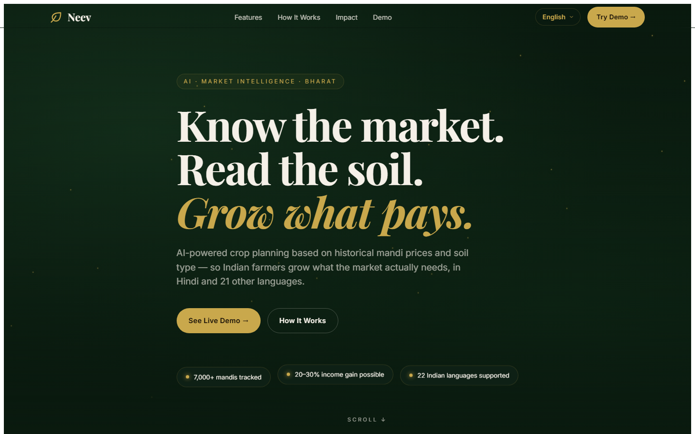
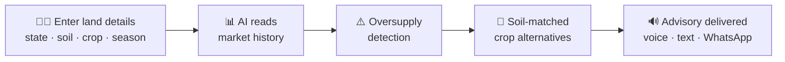

<div align="center">

# 🌱 Neev

### Know the market. Read the soil. Grow what pays.

AI-powered crop planning for Indian farmers, built on historical mandi prices and soil type, so farmers grow what the market actually needs, in Hindi and 21 other languages.

[](https://neev-510df.web.app/)




</div>

---

## 📑 Table of Contents

- [About](#-about)
- [How It Works](#-how-it-works)
- [Key Features](#-key-features)
- [Data Sources](#-data-sources)
- [Tech Stack](#-tech-stack)
- [Project Structure](#-project-structure)
- [Getting Started](#-getting-started)
- [Roadmap](#-roadmap)
- [Author](#-author)

---

## 💡 About

**Why farmers lose money every season:**

- **Market blindness:** most farmers plant whatever sold well last season. When everyone does the same, supply floods the mandi and prices crash.
- **Wrong crop, wrong soil:** crops are often chosen without matching them to the land, which lowers yield.
- **Inaccessible intelligence:** price data exists, but it lives in English spreadsheets on government websites that most farmers never see.

**What Neev does:** a farmer enters their state, soil type, planned crop and season. Neev reads years of mandi price history, flags crops heading for oversupply, and suggests better-suited alternatives, delivered as a simple voice or text advisory in the farmer's own language.

---

## ⚙️ How It Works



1. **Enter your land details:** state, soil type, the crop you plan to grow and the season.
2. **AI reads market history:** 5 years of mandi prices for that crop and region.
3. **Oversupply detection:** warns if last year's production points to a price crash.
4. **Crop alternatives matched:** 2–3 crops that suit your soil and face less competition.
5. **Advisory delivered:** a clear recommendation in your language.

---

## ✨ Key Features

| Feature | Description |
|---|---|
| 📈 **Mandi Price History** | 5-year price trends shown as simple signals instead of spreadsheets. |
| ⚠️ **Oversupply Alerts** | Flags crops likely to face a glut and low prices next season. |
| 🌾 **Soil-Matched Alternatives** | Recommends crops that suit the farmer's soil and have healthier demand. |
| 🗣️ **22 Indian Languages** | Built for Hindi and 21 other languages, with voice input and output. |
| 📶 **Offline Capable** | Designed to work on basic phones with unreliable internet. |
| 💬 **WhatsApp Delivery** | Crop plans delivered where farmers already are. |
| 🧪 **Interactive Demo** | Try it live: pick a state, soil, crop, season and language. |

---

## 🏛️ Data Sources

Neev is designed around public Indian government data:

| Source | Used for |
|---|---|
| **Agmarknet** | Daily mandi arrivals and prices |
| **eNAM** | National agricultural market data |
| **data.gov.in** | Open government datasets on crop production |
| **ICAR** | Soil and crop suitability knowledge |
| **IMD Weather API** | Seasonal weather context |
| **PM-Kisan / PMFBY** | Links to farmer support and crop insurance schemes |

---

## 🛠️ Tech Stack

| Layer | Technology |
|---|---|
| **Frontend** | HTML5, CSS3, vanilla JavaScript |
| **Data** | Agmarknet and data.gov.in mandi price data |
| **Storage** | Browser localStorage for recent selections |
| **Hosting** | Firebase Hosting |

---

## 📁 Project Structure

```
Neev/
├── index.html       # Landing page, how-it-works, live demo and impact sections
├── style.css        # Design system and responsive layout
├── script.js        # Demo logic, price analysis, recommendations, language switcher
├── firebase.json    # Firebase Hosting configuration
└── docs/
    └── screenshot.png
```

---

## 🚀 Getting Started

**Prerequisites:** a modern browser and [Node.js](https://nodejs.org) (only for the local server).

```bash
# 1. Clone the repository
git clone https://github.com/dhruvagrawal514-boop/Neev.git
cd Neev

# 2. Start a local server
npx serve .
```

Then open the URL it prints (usually `http://localhost:3000`).

**Deploy to Firebase**

```bash
npm install -g firebase-tools
firebase login
firebase deploy
```

---

## 🗺️ Roadmap

- [x] Landing page and interactive crop-planning demo
- [x] Oversupply detection and soil-matched alternatives
- [x] Language switcher
- [ ] Live multilingual voice through the Bhashini API
- [ ] WhatsApp Business API delivery
- [ ] FastAPI backend with retrieval-augmented (RAG) recommendations
- [ ] Offline mode with weekly cached market data
- [ ] Android app for low-end phones

---

## 👤 Author

**Dhruv Agrawal**

[](https://www.linkedin.com/in/dhruv-agrawal-0b8a46204)
[](https://github.com/dhruvagrawal514-boop)
[](mailto:dhruvagrawal514@gmail.com)

<div align="center">

If you like this project, consider giving it a ⭐

</div>
